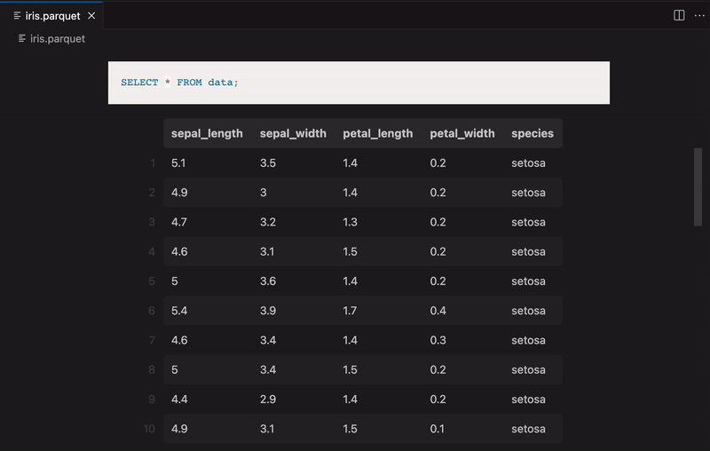

# Flat File Explorer

Explore Parquet and CSV files with DuckDB SQL (VSCode Extension)

## Introduction

Flat File Explorer is a VSCode extension that provides a preview of and SQL query
execution against Apache Parquet and CSV files. Under the hood, SQL queries are executed
by [DuckDB](https://duckdb.org/), which implements efficient partial reading and
parallel query processing.

## Quick Start

1. Install the [Flat File Explorer extension](https://marketplace.visualstudio.com/items?itemName=DeflateAwning.flat-file-explorer)
from the marketplace.

2. Open a Parquet (.parquet, .pq) file or CSV (.csv) and the extension will activate.

## Acknowlegements - Forked

Flat File Explorer is a fork of the [AdamViola's Parquet Explorer](https://github.com/adamviola/parquet-explorer), which appears to be semi-abandoned. This fork includes many improvements, including:

* Fast copying the query's source.
* Automatically reload if file changes on disk.
* Shows a hint to press Ctrl+Enter to query.
* Support for CSV files (in addition to Parquet files).
* Various bug fixes.
* Full rewrite in TypeScript.
* Actively maintained.
